# StayAware Complete Relational Model UML (23 Classes)

This model adds 13 classes to the existing 10 FIRMS MODIS data classes to support the features proposed in the project PDF. Each class represents a relational table. PK denotes a primary key, FK a foreign key, UK a unique key, and FK_nullable a nullable foreign key. The original CSV field mappings remain unchanged.

## Project Feature Mapping

| Feature in the PDF | Relevant Classes | Support |
|---|---|---|
| Side-by-side country comparison: burned area, percentage change, and trends | Comparison, ComparisonCountry, Metric, CountryMetricObservation | Store the metric, selected countries, time range, and filters; retrieve country metrics using consistent definitions and filters |
| Historical trend analysis: graphs and charts | Comparison, CountryMetricObservation | Use time_grain for daily, monthly, or annual intervals and chart_type for the visualization type; build chronologically ordered series |
| Personalized recommendations based on searches, selections, and comparisons | UserAccount, UserActivity, ActivityCountry, Recommendation | Record user activity and selected countries; generate comparison suggestions with scores and reasons |
| Prediction of future wildfire severity in a geographical region | PredictionModel, ModelDataset, SeverityPrediction | Store model versions, training inputs, data cutoff times, forecast intervals, and outputs; this version uses countries as prediction regions |
| Interactive maps | MapView, Country, HotspotDetection | Save the viewport, time range, and selected layer; plot hotspots using latitude and longitude |
| Multiple data sources and newly imported data | DataSource, Dataset, ProcessingVersion | Identify sources such as NASA FIRMS and OWID and their data versions; support metrics from multiple sources for the same country |

Class count: 10 original data classes + 3 metric and source classes + 6 user, comparison, and recommendation classes + 3 prediction classes + 1 map class = **23**.

## Complete UML

```mermaid
classDiagram
direction TB
class Country {
  +bigint country_id PK
  +varchar country_name UK
}
class Satellite {
  +bigint satellite_id PK
  +varchar satellite_name UK
}
class Instrument {
  +bigint instrument_id PK
  +varchar instrument_name UK
}
class Dataset {
  +bigint dataset_id PK
  +bigint source_id FK
  +varchar dataset_name UK
}
class ProcessingVersion {
  +bigint version_id PK
  +bigint dataset_id FK
  +varchar version_label
}
class DetectionType {
  +smallint type_code PK
  +varchar type_name UK
}
class Acquisition {
  +bigint acquisition_id PK
  +bigint satellite_id FK
  +bigint instrument_id FK
  +datetime acquired_at_utc
  +int year DERIVED
}
class HotspotDetection {
  +bigint detection_id PK
  +bigint country_id FK
  +bigint acquisition_id FK
  +bigint version_id FK
  +smallint type_code FK
  +decimal latitude
  +decimal longitude
  +smallint confidence
  +char daynight
}
class ThermalMeasurement {
  +bigint detection_id PK_FK
  +decimal brightness_k
  +decimal bright_t31_k
  +decimal frp_mw
}
class PixelFootprint {
  +bigint detection_id PK_FK
  +decimal scan
  +decimal track
}
Dataset "1" --> "0..*" ProcessingVersion : has
Satellite "1" --> "0..*" Acquisition : observes
Instrument "1" --> "0..*" Acquisition : measures
Country "1" --> "0..*" HotspotDetection : contains
Acquisition "1" --> "0..*" HotspotDetection : groups
ProcessingVersion "1" --> "0..*" HotspotDetection : processes
DetectionType "1" --> "0..*" HotspotDetection : classifies
HotspotDetection "1" *-- "1" ThermalMeasurement : owns
HotspotDetection "1" *-- "1" PixelFootprint : owns
class DataSource {
  +bigint source_id PK
  +varchar source_name UK
  +varchar source_url
}
class Metric {
  +bigint metric_id PK
  +varchar metric_name UK
  +varchar unit
  +varchar aggregation_rule
}
class CountryMetricObservation {
  +bigint observation_id PK
  +bigint country_id FK
  +bigint metric_id FK
  +bigint dataset_id FK
  +bigint version_id FK_nullable
  +datetime period_start_utc
  +datetime period_end_utc
  +decimal value
  +varchar filter_signature
  +varchar derivation_method
}
class UserAccount {
  +bigint user_id PK
  +varchar username UK
  +datetime created_at
}
class Comparison {
  +bigint comparison_id PK
  +bigint user_id FK_nullable
  +bigint metric_id FK
  +varchar title
  +datetime start_at_utc
  +datetime end_at_utc
  +varchar time_grain
  +varchar chart_type
  +varchar filter_signature
}
class ComparisonCountry {
  +bigint comparison_id PK_FK
  +bigint country_id PK_FK
  +int display_order
}
class UserActivity {
  +bigint activity_id PK
  +bigint user_id FK
  +bigint comparison_id FK_nullable
  +bigint metric_id FK_nullable
  +varchar activity_type
  +varchar search_text_nullable
  +datetime occurred_at
}
class ActivityCountry {
  +bigint activity_id PK_FK
  +bigint country_id PK_FK
}
class Recommendation {
  +bigint recommendation_id PK
  +bigint user_id FK
  +bigint comparison_id FK
  +decimal score
  +varchar reason
  +varchar algorithm_version
  +datetime generated_at
}
class PredictionModel {
  +bigint model_id PK
  +bigint target_metric_id FK
  +varchar model_name
  +varchar model_version
  +datetime trained_at
  +datetime training_cutoff_utc
  +varchar severity_definition
}
class ModelDataset {
  +bigint model_id PK_FK
  +bigint dataset_id PK_FK
  +varchar snapshot_reference
  +varchar filter_signature
}
class SeverityPrediction {
  +bigint prediction_id PK
  +bigint model_id FK
  +bigint country_id FK
  +datetime issued_at_utc
  +datetime input_cutoff_utc
  +datetime target_start_utc
  +datetime target_end_utc
  +decimal predicted_value
  +varchar severity_level
}
class MapView {
  +bigint map_view_id PK
  +bigint user_id FK_nullable
  +bigint comparison_id FK_nullable
  +bigint country_id FK_nullable
  +decimal center_latitude
  +decimal center_longitude
  +decimal zoom
  +varchar layer_kind
  +datetime start_at_utc
  +datetime end_at_utc
}
DataSource "1" --> "0..*" Dataset : supplies
Country "1" --> "0..*" CountryMetricObservation : has
Metric "1" --> "0..*" CountryMetricObservation : defines
Dataset "1" --> "0..*" CountryMetricObservation : supplies
ProcessingVersion "0..1" --> "0..*" CountryMetricObservation : provenance
UserAccount "0..1" --> "0..*" Comparison : saves
Metric "1" --> "0..*" Comparison : compares
Comparison "1" *-- "2..*" ComparisonCountry : includes
Country "1" --> "0..*" ComparisonCountry : participates
UserAccount "1" --> "0..*" UserActivity : generates
Comparison "0..1" --> "0..*" UserActivity : referenced
Metric "0..1" --> "0..*" UserActivity : selected
UserActivity "1" *-- "0..*" ActivityCountry : selects
Country "1" --> "0..*" ActivityCountry : selected
UserAccount "1" --> "0..*" Recommendation : receives
Comparison "1" --> "0..*" Recommendation : suggested
Metric "1" --> "0..*" PredictionModel : target
PredictionModel "1" *-- "1..*" ModelDataset : trained_on
Dataset "1" --> "0..*" ModelDataset : training_input
PredictionModel "1" --> "0..*" SeverityPrediction : produces
Country "1" --> "0..*" SeverityPrediction : forecast_for
UserAccount "0..1" --> "0..*" MapView : saves
Comparison "0..1" --> "0..*" MapView : visualizes
Country "0..1" --> "0..*" MapView : focuses
```

## The 13 Additional Classes

| Class | Description |
|---|---|
| DataSource | Data provider and source URL; Dataset gains a source_id foreign key |
| Metric | Metric name, unit, and aggregation rule, such as hotspot detection count, aggregated FRP, or burned area |
| CountryMetricObservation | A country's metric value for a given time interval, source, and filter definition; supports both external burned-area data and aggregates calculated from hotspots |
| UserAccount | User identity for saved comparisons, activity history, and personalized recommendations |
| Comparison | Configuration for comparisons and trend charts; supports one metric, multiple countries, and time filters |
| ComparisonCountry | Resolves the many-to-many relationship between Comparison and Country |
| UserActivity | A user's search, select, or compare action; may reference a metric or an existing comparison |
| ActivityCountry | Countries associated with an activity; a search or comparison may involve multiple countries |
| Recommendation | Suggests a Comparison to a user and stores its score, reason, and algorithm version |
| PredictionModel | Model name, version, target metric, training time, and severity definition |
| ModelDataset | Resolves the many-to-many relationship between models and training datasets; stores training snapshot references and filters |
| SeverityPrediction | A model's prediction for a country over a future time interval |
| MapView | Map center, zoom, time range, and layer selection; may reference an existing comparison or a single country |

## Relationships and Implementation Constraints

### Preserving the Original CSV Data Model

Country, Satellite, Instrument, Dataset, ProcessingVersion, DetectionType, Acquisition, HotspotDetection, ThermalMeasurement, and PixelFootprint retain their existing structures, except that Dataset gains source_id. See the [original 10-class model](firms-modis-relational-model.md) for the original field mappings.

- Thermal measurements and pixel information remain one-to-one components of a hotspot detection.
- ProcessingVersion has UNIQUE(dataset_id, version_label). Parse acq_time as HHMM in UTC and derive year from the acquisition date.
- Retain the original validation rules for longitude, latitude, confidence, and day/night flags.

### Comparisons, Metrics, and Trends

- ComparisonCountry has the composite primary key (comparison_id, country_id) and UNIQUE(comparison_id, display_order).
- A complete Comparison must contain at least two distinct countries. Foreign keys alone cannot enforce a minimum number of members; validate this when committing the transaction.
- CountryMetricObservation has UNIQUE(country_id, metric_id, dataset_id, period_start_utc, period_end_utc, filter_signature, version_id). When version_id is NULL, use NULLS NOT DISTINCT or an equivalent unique index to prevent duplicate records with null versions.
- version_id is nullable to support burned-area datasets without a FIRMS processing version. When present, it must belong to the same dataset_id.
- All time intervals are start-inclusive and end-exclusive: [start, end), with start < end. Align observations used in a comparison according to time_grain and Metric.aggregation_rule.
- CountryMetricObservation.value is either an externally supplied metric value or a materialized aggregate. derivation_method records how it was calculated, while filter_signature stores a deterministic signature of filters such as hotspot type, minimum confidence, satellite, and processing version. Compare observations only when their metric definitions and filters are consistent.
- Multiple datasets or versions may provide values for the same country, metric, and period. Select the source and version explicitly and label them in charts; do not sum overlapping sources.
- Calculate percentage change from observations with consistent definitions and filters: ((current value - baseline value) / baseline value) × 100%. Return NULL or N/A when the baseline is zero or missing.
- Trend charts and comparisons reuse the same data and configuration. Do not separately store percentage changes that can be recalculated from observations.
- New identifiers such as source_id and metric_id are generated by the application. unit and aggregation_rule come from metric metadata, rather than columns in the current hotspot CSV.

### User Activity and Recommendations

- UserActivity.activity_type allows only search, select, and compare. occurred_at records the activity time.
- ActivityCountry has the composite primary key (activity_id, country_id). A free-text search may not yet identify any countries, so an activity may have zero associated countries.
- UserActivity.comparison_id and metric_id are nullable; a search does not require creating a comparison.
- Comparison.user_id and MapView.user_id are nullable to support use without signing in. Personalized recommendations must reference a UserAccount.
- Recommendation records are generated by an application algorithm and are not present in the CSV. The recommendation generator reads the user's UserActivity and ActivityCountry records and produces a reusable Comparison.
- The range and meaning of Recommendation.score depend on the scoring definition associated with algorithm_version. Do not assume it is a percentage probability.
- When deleting a user, also remove their activity and recommendations. Handle saved comparisons and map views according to the application's data retention policy.

### Predictions

- PredictionModel has UNIQUE(model_name, model_version). ModelDataset has the composite primary key (model_id, dataset_id).
- ModelDataset.snapshot_reference must identify an immutable version, file hash, or snapshot manifest. The current dataset name alone is insufficient to reproduce the training data.
- PredictionModel.target_metric_id defines the unit and meaning of predicted_value. severity_definition specifies the classification thresholds for severity_level. FRP does not automatically represent wildfire severity.
- SeverityPrediction.target_start_utc < target_end_utc and target_start_utc >= issued_at_utc. input_cutoff_utc <= issued_at_utc, and the training data cutoff must not be later than the prediction issue time.
- Use UNIQUE(model_id, country_id, issued_at_utc, target_start_utc, target_end_utc) to retain predictions issued at different times.
- Prediction records are produced by training and inference workflows; they cannot be mapped directly from a CSV column. The UML specifies storage for models and predictions, rather than demonstrating that a validated prediction model already exists.
- This version uses countries as prediction regions to match the CSV's country field. Support for states, provinces, or arbitrary polygons would require a Region class and spatial boundaries; do not infer administrative regions from coordinates alone.
- Backtesting for future periods must use time-based splits. Training and feature computation must not use data that became available after the prediction issue time.

### Maps

- MapView.country_id is nullable for a global view. comparison_id is nullable for independent hotspot browsing.
- Filter HotspotDetection by time range, country, hotspot type, and other criteria. When comparison_id is present, reuse the comparison's selected countries and filters.
- layer_kind may include hotspots, country_metric, and predicted_severity. Choropleth maps of country metrics and predictions require additional country boundary data; the current CSV contains only hotspot coordinates.
- MapView stores view configuration, rather than screenshots, map tiles, or copies of individual hotspot records. Map searches and selections may also be recorded in UserActivity.
- The PDF mentions satellite imagery, but the current CSV contains no imagery paths or image content. Imagery overlays require a separate imagery service. This version initially supports hotspot and country metric display.

## Data Capabilities and Limitations

1. The current FIRMS CSV provides hotspot detections and thermal measurements, but no actual burned area. Burned-area comparisons require importing the previously supplied annual-area CSVs or another valid burned-area source into CountryMetricObservation.
2. scan × track relates to pixel dimensions and must not be treated as actual burned area. Hotspot detection counts also do not represent counts of distinct wildfires.
3. DataSource and Dataset support continued data imports. The existing CSV filename does not establish that the data is updated in real time.
4. User activity, recommendations, models, predictions, and map settings are new application data that must be generated by application workflows.
5. This update changes only the UML design documentation. It does not modify the original CSV, database, or application code.

The requirements are based on the StayAware project description in PM1_Group2.pdf. Hotspot field meanings follow the [NASA FIRMS MODIS official documentation](https://firms.modaps.eosdis.nasa.gov/content/descriptions/FIRMS_MODIS_Firehotspots.html).

